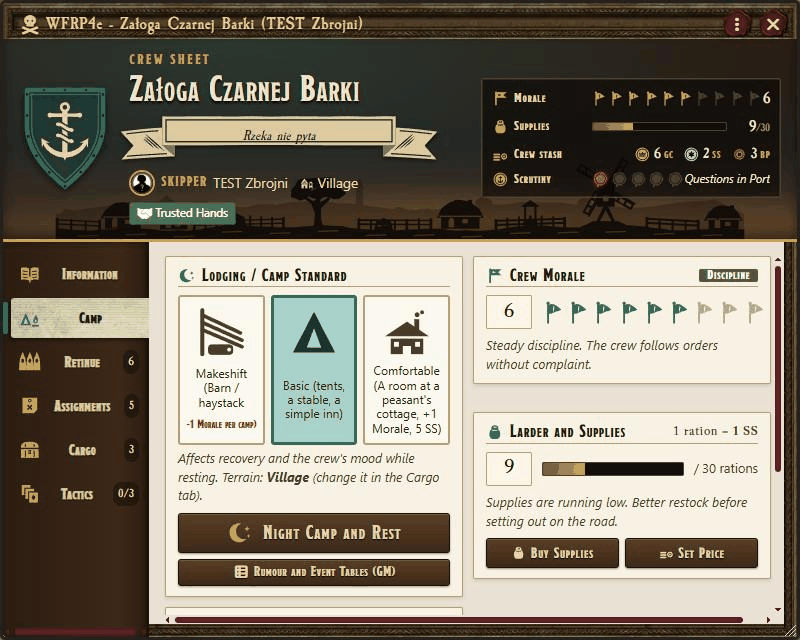
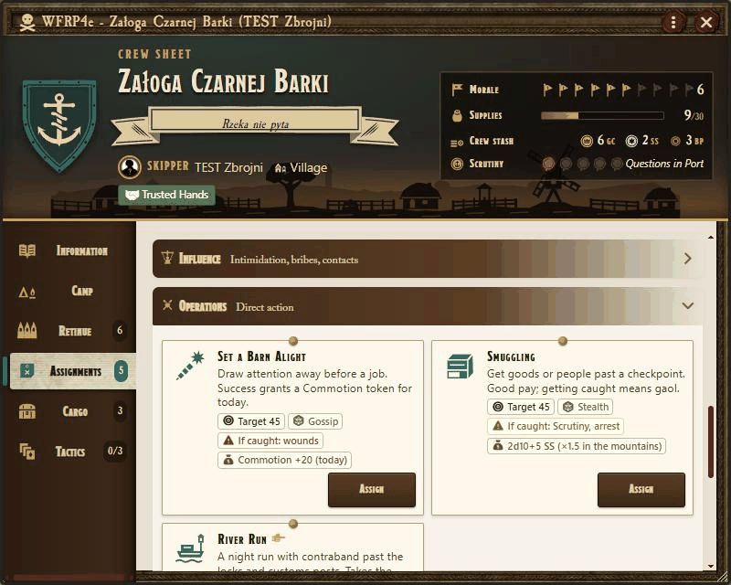
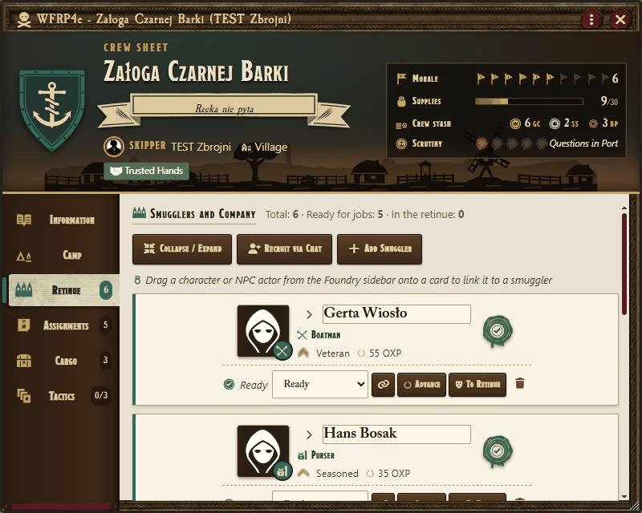
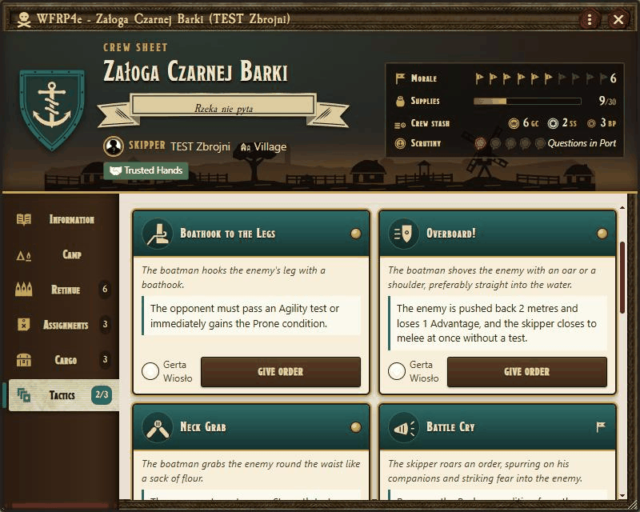
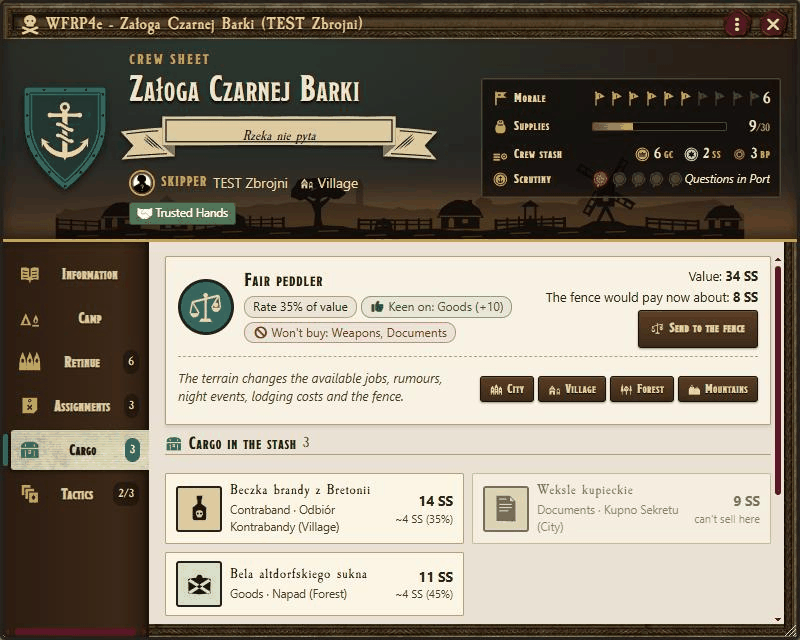
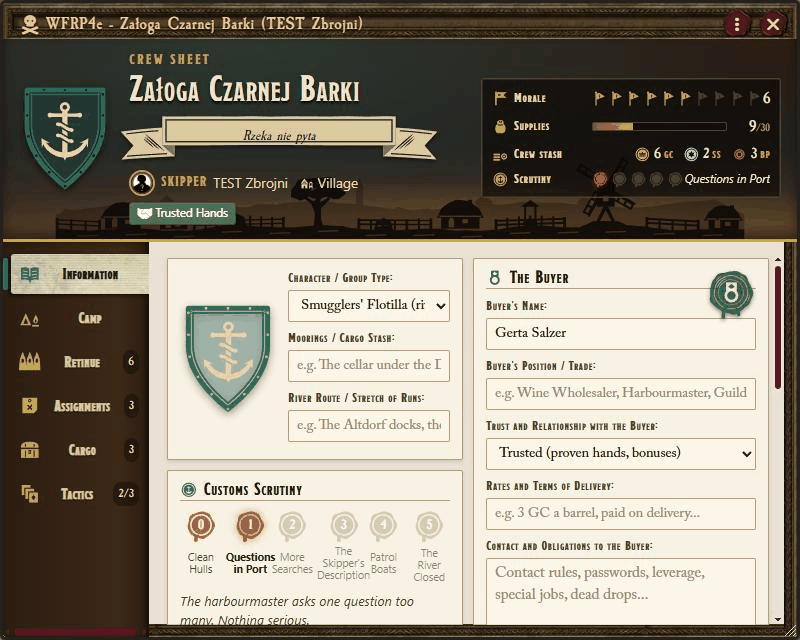
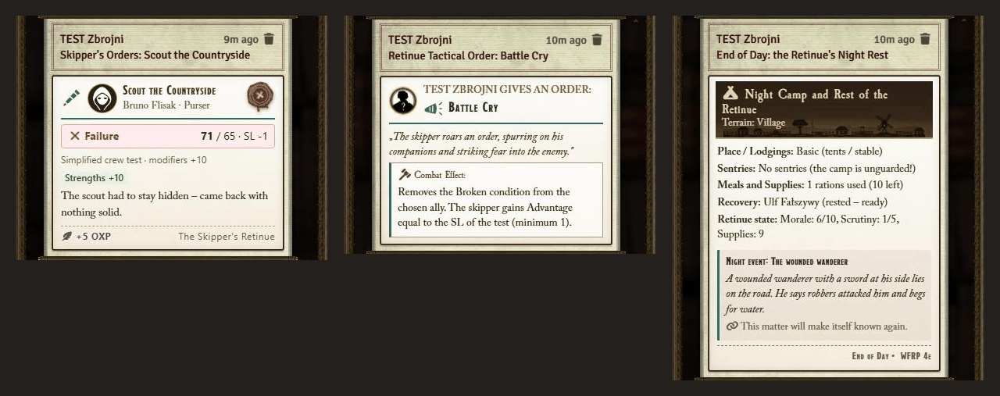

# WFRP4e – Underworld Crew (`wfrp4e-underworld`)

**English** | [Polski](README.pl.md)

A module for **Foundry VTT v13–v14** and the **Warhammer Fantasy Roleplay 4th Edition** system.
It lets a player character – the **Chief** – run a mobile band of outlaws: send followers on jobs, fence hot loot, make camp each night, advance followers and give them orders in combat.

The crew works for a **Patron** ("The Man"), who takes a cut of every haul. Its activity draws the attention of the watch (**Heat**) and affects the crew's mood (**Morale**).

The interface follows Foundry's language: **English** or **Polish** (any other language falls back to English).

---

## 📥 Installation

In Foundry: **Add-on Modules → Install Module**, paste this into *Manifest URL*:

```
https://github.com/TomasWarchol/wfrp4e-underworld/releases/latest/download/module.json
```

Foundry also installs the required **WFRP4e – Companion Library** (`wfrp4e-companion-lib`). Enable both modules in your world.

## 📦 Requirements

* Foundry VTT v13–v14 and the WFRP4e system 9.0+.
* **WFRP4e – Companion Library** (`wfrp4e-companion-lib`) – the shared library of the series: the GM's Companion Hub, character sheet buttons, token tools and calendar helpers.
* Optional: Simple Calendar. Without it the module uses Foundry's own calendar.

## 🔑 Access

* The GM enables the crew for a character in the **Companion Hub** (`/hub`, a button in the Actors directory or on the token toolbar).
* The player who owns that character then sees a skull icon in the character sheet header.
* Open the crew sheet with the sheet icon, the chat command `/crew` (also `/underworld`, `/szajka`) or the macro `game.underworld.openGangSheet()`.

---

## 🗂️ Crew sheet

| Tab | Contents |
|---|---|
| **Information** | Name, motto, patron and their cut, hideout, turf, enemies, code, Heat. |
| **Camp** | Morale, supplies (max. 30 rations), stash, deposits and withdrawals, buying supplies, night camp. |
| **Retinue** | Crew members: role, status, strengths and flaws, rank, gear, linked Foundry actor, recruitment. |
| **Assignments** | Jobs for ready members, grouped into categories and filtered by terrain. On top: terrain, active preparation tokens, racket and loot count. |
| **Loot** | Terrain switch (GM), the fence for the current terrain, loot in the hideout with prices, preparation tokens and racket. |
| **Tactics** | The chief's retinue (max. 3 people) and tactical orders for combat. |

Member statuses: **Ready**, **Busy** (after a job, until the end of the day), **Resting**, **Wounded**, **Arrested**, **Dead**.

### 📖 Company Ledger look

By default the sheet looks like a war ledger: a banner with the company type's crest, the motto on a ribbon and the terrain skyline, meters for Morale, supplies, the stash and the pressure track, and ribbon bookmarks on the left. Drag a ready member's portrait onto a job card to send them, or onto a free retinue place. Everything also works from the keyboard (arrow keys switch tabs, Enter opens the job dialog). The client setting **Company sheet style** brings back the classic sheet.

| | |
|---|---|
|  |  |
|  |  |
|  |  |



---

## 📅 Crew rhythm (world setting)

* **Daily** (default): a job resolves as soon as it is sent, and the crew makes camp every night.
* **Weekly – Crew Week**: players only **plan** assignments. The GM clicks **Resolve the Crew Week** on the Camp tab: the module resolves every planned job, then a week in camp (food, healing, an event, raids, desertion), and posts **one report** with all the rolls. It can also advance world time by 7 days.
* **GM queue in daily mode** (separate setting, off by default): jobs sent by players wait for the GM, who resolves them with **Resolve Assignments** or by running the night camp.

---

## 🏴 Company types

The **Type** field on the Information tab decides what the company is. Each type has its own roles, jobs, wording and night events; the rest (roster, ranks, morale, supplies, treasury, camp, orders) is shared. Changing the type of a company with members asks for confirmation and converts their roles.

- **Underworld Crew**: everything described below.
- **Armed Company**: a Captain and an Employer who pays instead of taking a cut. Infamy replaces Heat. Roles: Sergeant, Halberdier, Crossbowman, Standard Bearer, Barber-Surgeon, Quartermaster. Jobs: Patrol, Garrison Duty, Requisition, Escort, Contract, Drill, selling trophies, tending the wounded. Spoils are trophies, which never go hot. This type does not use the world's RollTables.
- **Outlaw Band**: the crew's roles and wording, with a Protector who takes a share. Jobs suited to roads and forests (no rackets, burglary or pickpocketing) plus Turn on the Hunters (Heat −1 and weapons), Ransom and Bridge Toll. Uses the world's RollTables and adds its own night events.
- **Smugglers' Flotilla**: a Skipper and a Buyer who pays for the cargo. Customs Scrutiny replaces Heat. Roles: Carter / Smuggler, Helmsman, Boatman, Lookout, Forger, Purser. Contraband Pickup brings contraband to the stash; River Run 🎯 takes the most valuable load to the buyer for 2.5 times its value (the target is the route), and a failed run sinks it. The Stash lowers Scrutiny.
- **Informant Network**: a Spymaster and a Principal who pays for reports. Exposure replaces Heat. Roles: Shadow / Tail, Go-Between / Forger, Chameleon / Hedge Healer, Eavesdropper, Courier, Enforcer. Buy a Secret, Intercept a Courier and Swap a Letter 🎯 bring documents. Sell them to the secret-buyer, or hand the best one to the principal in Report to the Principal for 1.25 times its value with no risk.
- **Secret Brotherhood**: a High Priest and a Dark Master who takes a tithe. Suspicion replaces Heat. Roles: Acolyte, Zealot, Spy, Assassin, Orator, Alchemist. Jobs: Ritual, Infiltration, Abduction 🎯 and The Stone Circle in the wilds. New believers join through recruitment, as part of the story.

Each role of these types gives its own 3–5 combat orders, named for the type (the halberdier's Halberd Hook, the boatman's Overboard!, the zealot's Martyrdom); the mechanics are those of the crew's orders.

**Night events.** The Underworld Crew draws from the terrain tables. The other types draw part of their nights (the Outlaw Band one in four, the rest half) from their own table and the rest from terrain events without crime motifs. Own events can be limited to terrains. The first time a type needs its table, the module creates it as an editable world RollTable; the GM's Tables button opens it. If the GM deletes it, the module's built-in events are used. Each company remembers which events it has already seen.

## 🎲 Jobs

Every job shows its target number, skill, failure risk and expected reward. If the member is linked to an actor sheet the user controls, the module makes a **normal WFRP4e skill test** from that sheet, with the crew modifiers in the test dialog. Otherwise it rolls **1d100 against the job's target** (01–05 always succeeds, 96–00 always fails). All rolls appear in the chat.

Terrain: **C** – city, **V** – village, **F** – forest, **M** – mountains. Some job names change with the terrain. Jobs marked 🎯 let you **choose a target**.

| Job | Terrain | Target | Skill | Risk | On success |
|---|---|---|---|---|---|
| Scout the Area | CVFM | 55 | Perception | low | rumour, **Recon** token; SL 3+: **Lead** |
| Shadow a Target | CV | 50 | Stealth | stealth | report, **Recon** token |
| Listen at the Tavern / Question the Peasants | CV | 55 | Gossip | low | rumour (costs 1d2 s); SL 3+: **Lead** |
| Scavenge and Forage | CVFM | 50 | Stealth | stealth | 1d3 rations + 1d8+1 s |
| Pickpocketing 🎯 | CV | 45 | Sleight of Hand | stealth | 1d10+5 s × target; chance of a valuable |
| Burglary 🎯 | C | 40 | Pick Lock | stealth | loot to sell (SL 3+: two) |
| Farmyard Theft 🎯 | V | 50 | Stealth | stealth | rations + goods |
| Poaching | FM | 50 | Outdoor Survival | low | 1d3+1 rations |
| Highway Robbery / Raid a Caravan 🎯 | FM | 45 | Intimidate | violent | loot (ore in the mountains) |
| Raid a Mine 🎯 | M | 40 | Stealth | violent | ore to sell |
| Fence the Loot | CVFM | 45 | Haggle | stealth | cash for the chosen loot |
| Intimidation / Extortion | CV | 45 | Intimidate | violent | 1d8+4 s (failure: −1 Morale) |
| Protection Racket | C | 45 | Intimidate | violent | 1d6 s every night in the city |
| Spread Rumours | CV | – | – | – | no test |
| Bribery | CVM | 45 | Gossip | stealth | release from arrest (15 s), Heat −1 (20 s) or a favour |
| The Man's Network | C | – | – | – | a message to the syndicate |
| Diversion | CVFM | 45 | Gossip | violent | **Commotion** token for today |
| Sabotage | CVFM | 40 | Trade | violent | target destroyed (narrative) |
| Smuggling | CVFM | 45 | Stealth | stealth | 2d10+5 s (×1.5 in the mountains) |
| Forge Documents | C | 40 | Trade | stealth | a document (narrative) |
| Cover Tracks | CVFM | 45 | Stealth | low | Heat −1, fewer night troubles |
| Tend the Wounded | CVFM | – | – | – | Wounded → Resting (with a Surgeon's Bag: Ready) |

Coins go to the stash **after the Patron's cut** (25% by default, world setting). Every job grants **Operational XP (OXP)**: success +10 (SL ≥ 3: +15), failure +5.

### 🎯 Target choice, ♟️ preparation tokens, 💰 loot

* **Easy** target: +20, half the loot. **Ordinary**: no change. **Rich**: −20, double loot, and **any failure** counts as SL −2.
* **Recon** (+20 to the next theft or robbery), **Commotion** (+20 to the next tested job today – the players' party can use it too), **Lead** (a rich target without the −20 penalty).
* Burglaries, robberies and raids bring **loot** with a category and a value. Fresh loot is **hot** for 2 nights: the fence pays 20 points less, and a raid on an unguarded camp takes it.
* Each terrain has its own **fence** (dockside fence, fair peddler, forest traders, dwarf smugglers) with a base rate, favourite categories and categories it refuses.

### Failure risk

| Risk | SL −2 / −3 | SL −4 or worse |
|---|---|---|
| low | none | Heat +1 |
| stealth | Heat +1 | **Arrested** for 1d3 nights, Heat +1 |
| violent | **Wounded** | Wounded, Heat +1 |

---

## 🌙 Night camp

Lodging (makeshift, basic, comfortable), sentries, food, recovery, a night event from the terrain's table (**300 events** each for city, village, forest and mountains), a watch **raid** at high Heat, the city racket, flaws and strengths of the members, and **desertion** at low Morale – all resolved in one chat card.

Some night events are **role events** (6 per role in every table): if a capable member with that role (main or second) is in the crew, they roll d100 (50 + 10 per rank, max. 80). Success turns the event's effects into good ones and adds the resolution; a failure or no specialist leaves the base effects. **Chains** (18 per terrain): event A leaves a hook and the next night with an event brings its sequel B; B entries never come up at random.

## ⚔️ Retinue and tactical orders

Up to 3 members can join the chief's retinue. There are **39 orders** in three groups (offensive, control, protection) and **11 roles**: Bruiser, Shadow, Marksman, Provocateur, Scavenger, Carter, Arsonist, plus Scout, Fence / Forger, Charlatan and Swashbuckler. An order needs a member with the right role (**main or second**) or the Right Hand, and many orders are shared by several roles (e.g. Smoke Screen: Provocateur, Arsonist, Carter). Give them with a **Leadership test**, by **spending Advantage**, or as a **plain order** decided by the GM. One order per round – it uses the chief's Action. Target a token (**T**) first: the GM's client applies conditions such as Prone, Bleeding or Blinded through the WFRP4e system.

## 📈 Followers

Ranks bought with OXP (+10 / +20 / +30 to tests; rank 3 is the unique **Right Hand**), a **second role** for 80 OXP (from rank 1: its orders and specialty; the specialty bonus counts once), a **Former Trade** and story perks, gear from the stash (max. 2 items), and 30 strengths and 30 flaws set by the GM. Taking on new followers is always the GM's decision: no job or event adds people to the crew. The GM sends recruit proposals to the chat, where the GM or the chief's player picks a candidate.

## 🛠️ GM tools

* Manual editing of Morale, Heat, stash, statuses and bonuses.
* **Rumour and event RollTables**: a crew folder in the Tables tab with a rumour table and a camp event table for each terrain. Reference copies are in the **Underworld Crew – Rumours and Events** compendium, which is rebuilt in the world's language.
* **Custom rumours and events**: `data/rumors.<lang>.json` and `data/events.<lang>.json` replace the built-in city rumours and events for that language (a Polish rumour set ships as `rumors.pl.json`). The built-in event tables live in `data/events/<terrain>.<lang>.json` (fields `title`, `text`, `morale`, `supplies`, `coinsSS`, optionally `role`, `okText`, `ok`, `next`, `only`).

## 📜 Macros

```javascript
game.underworld.openGangSheet();                                    // crew of the selected token / your character
game.underworld.openGangSheet(game.actors.getName("Chief's name")); // a specific character
game.underworld.openHub();                                          // GM's Companion Hub
```

---

Unofficial fan content, not affiliated with Games Workshop or Cubicle 7. Code under the [MIT licence](LICENSE).
