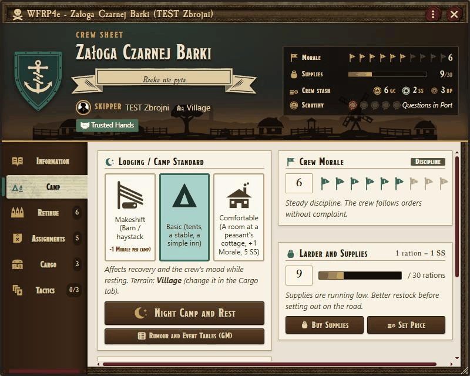
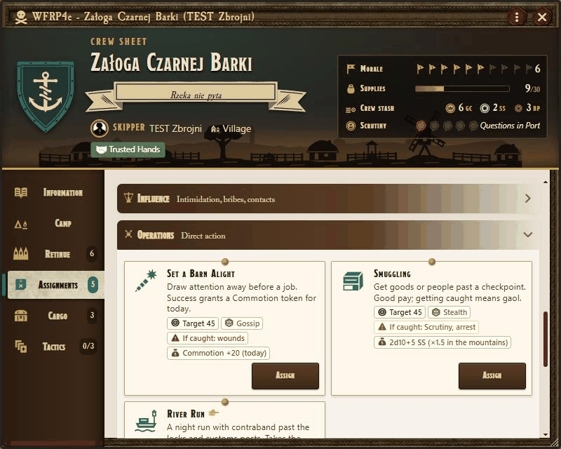
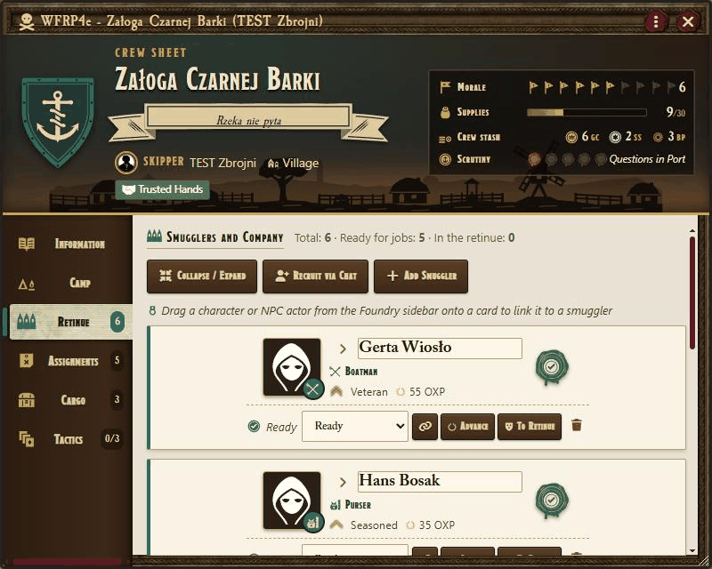
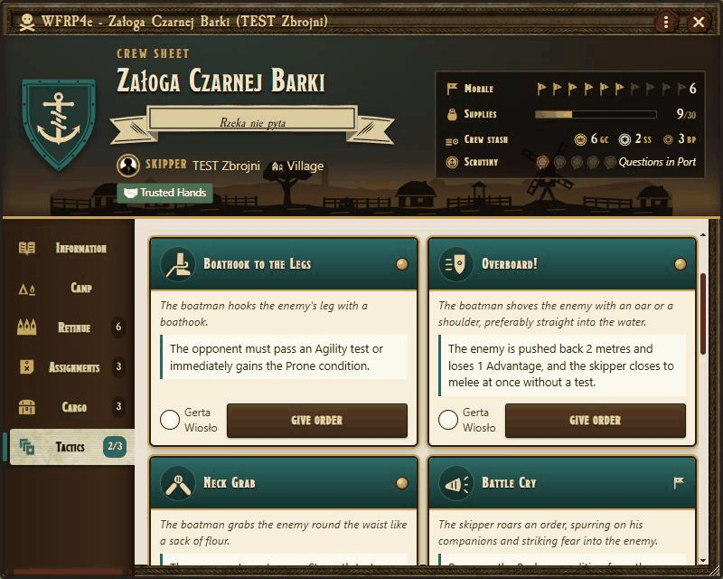
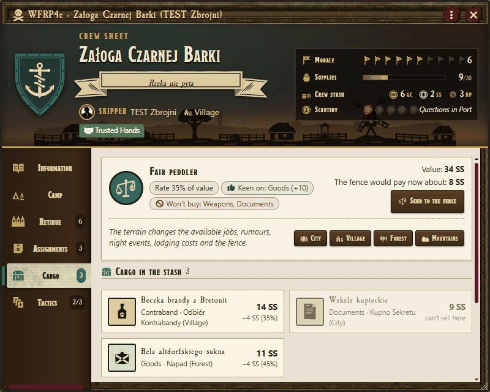
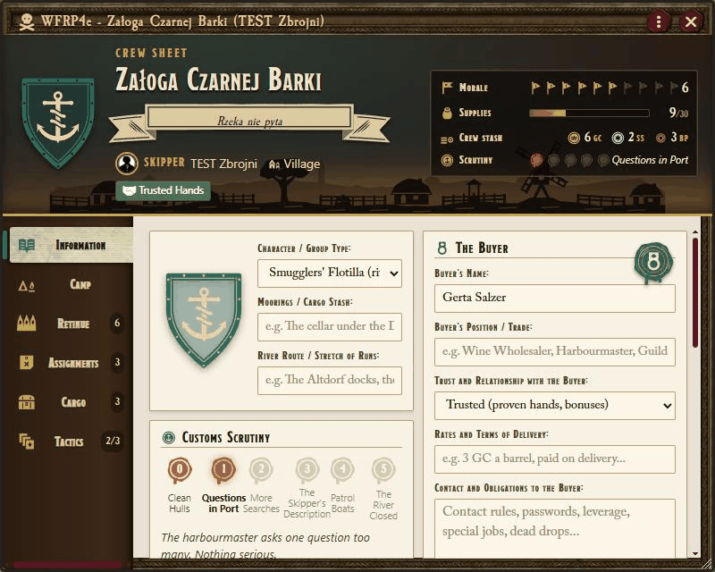
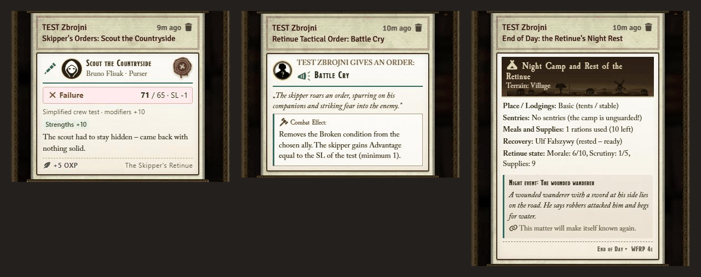

# WFRP4e – Szajka (Underworld Crew) (`wfrp4e-underworld`)

[English](README.md) | **Polski**

Moduł do **Foundry VTT v13–v14** dla systemu **Warhammer Fantasy Roleplay 4th Edition**.
Pozwala postaci gracza – **Hersztowi** – prowadzić mobilną szajkę banitów: wysyłać ludzi na zlecenia, rozbijać obóz na noc, rozwijać popleczników i wydawać im rozkazy w walce.

Szajka działa pod okiem **Patrona** („Człowieka”), który pobiera dolę od każdego łupu, a jej działalność przyciąga uwagę straży (**Rozgłos**) i wpływa na nastroje ludzi (**Morale**).

---

## 📥 Instalacja

W Foundry: **Dodatki → Zainstaluj moduł**, w polu *Manifest URL* wklej:

```
https://github.com/TomasWarchol/wfrp4e-underworld/releases/latest/download/module.json
```

Foundry doinstaluje też wymaganą bibliotekę **WFRP4e – Companion Library** (`wfrp4e-companion-lib`). Włącz oba moduły w świecie.

Język interfejsu przełącza się razem z językiem Foundry (polski lub angielski; inne języki dostają angielski).

## 📦 Wymagania

* Foundry VTT v13–v14 i system WFRP4e 9.0+.
* Moduł **WFRP4e – Companion Library** (`wfrp4e-companion-lib`, biblioteka wspólna serii: Centrum Dodatków MG, przyciski na kartach postaci, pasek narzędzi, kalendarz). Musi być zainstalowany i włączony w świecie.
* Opcjonalnie Simple Calendar – bez niego moduł korzysta z kalendarza Foundry.

## 🔑 Dostęp

* MG włącza Szajkę dla wybranej postaci w **Centrum Dodatków MG** (`/hub`, przycisk w katalogu Aktorów lub na pasku tokenów).
* Gracz-właściciel postaci widzi wtedy ikonę czaszki w nagłówku karty postaci.
* Otwarcie panelu: ikona na karcie, komenda `/szajka` (także `/crew`, `/underworld`) lub makro `game.underworld.openGangSheet()`.

---

## 🗂️ Panel szajki

| Zakładka | Zawartość |
|---|---|
| **Informacje** | Nazwa, motto, patron i jego dola, kryjówka, teren, wrogowie, kodeks, Rozgłos. |
| **Obozowisko** | Morale, zapasy (maks. 30 racji), skarbiec, wpłaty i wypłaty, zakup zapasów, nocny postój. |
| **Świta** | Lista członków: rola, status, zalety i wady, ranga, rynsztunek, powiązany aktor Foundry, rekrutacja. |
| **Przydziały** | Zlecenia dla gotowych członków, pogrupowane w kategorie i zależne od terenu. Na górze: teren, aktywne żetony przygotowania, haracz i liczba łupów. |
| **Łupy** | Przełącznik terenu (MG), paser bieżącego terenu, łupy w kryjówce z wyceną, żetony przygotowania i haracz. |
| **Taktyka** | Świta Herszta (maks. 3 osoby) i rozkazy taktyczne do walki. |

Statusy członków: **Gotowy**, **Zajęty** (po zleceniu do końca dnia), **Odpoczywa**, **Ranny**, **Aresztowany**, **Martwy**.

### 📖 Wygląd Księgi Kompanii

Domyślnie panel wygląda jak księga wojenna: chorągiew z herbem typu kompanii, motto na wstędze i sylwetka terenu, mierniki Morale, zapasów, skarbca i presji oraz zakładki-wstążki po lewej. Portret gotowego członka przeciąga się na kartę zlecenia albo na wolne miejsce w Świcie. Wszystko działa też z klawiatury (strzałki przełączają zakładki, Enter otwiera okno zlecenia). Ustawienie klienta **Wygląd panelu kompanii** przywraca klasyczny panel. Zrzuty pokazują interfejs angielski.

| | |
|---|---|
|  |  |
|  |  |
|  |  |



---

## 📅 Rytm szajki (ustawienie świata)

* **Dzienny** (domyślny): zlecenie rozstrzyga się od razu po wysłaniu, a co noc rozgrywa się nocny postój.
* **Tygodniowy – Tydzień Szajki**: gracze tylko **planują** przydziały (członek jest „Zajęty” z zaplanowanym zleceniem). MG klika **Rozpatrz Tydzień Szajki** w zakładce Obozowisko: moduł rozpatruje po kolei wszystkie zlecenia, a potem tydzień w obozie (wyżywienie, żołd, leczenie, zdarzenie, obława, dezercja) i publikuje **jeden raport** ze wszystkimi rzutami. Opcjonalnie przesuwa czas świata o 7 dni.
  * Każdy członek wykonuje jedno zlecenie na tydzień, więc łupy i ryzyko liczą się raz na tydzień – bliżej rytmu Przedsięwzięć z WFRP. Nagrody DO są skalowane ×3.
  * Ranni zdrowieją przez tydzień, areszt trwa 1d2 tygodnie, wygodne kwatery kosztują ×3 (np. 30 ss w mieście), a nocne przypomnienie o postoju jest wyłączone.
  * Plan może anulować MG przyciskiem zwolnienia członka z zadania.
* **Kolejka MG w trybie dziennym** (osobne ustawienie, domyślnie wyłączone): zlecenia wysłane przez graczy czekają na MG. MG klika **Rozpatrz Przydziały** – wszystkie wyniki trafiają do jednego raportu – albo rozgrywa nocny postój, który najpierw rozpatruje zaległe przydziały. Zlecenia wysyłane przez MG rozstrzygają się od razu.

---

## 🏴 Typy kompanii

Pole **Typ** w zakładce Informacje decyduje, czym jest kompania. Każdy typ ma własne role, zlecenia, nazewnictwo i zdarzenia nocy, a reszta (lista członków, rangi, morale, zapasy, skarbiec, postój, rozkazy) jest wspólna. Zmiana typu kompanii z członkami wymaga potwierdzenia i przelicza ich role.

- **Szajka Półświatka**: wszystko, co opisano niżej.
- **Zbrojna Kompania**: Kapitan i Pracodawca, który płaci, zamiast pobierać dolę. Zła sława zastępuje Rozgłos. Role: Sierżant, Halabardnik, Kusznik, Chorąży, Cyrulik, Kwatermistrz. Zlecenia: Patrol, Warta, Rekwizycja, Eskorta, Kontrakt, Musztra, spieniężenie trofeów, opieka nad rannymi. Zdobycz to trofea, które nie są gorącym towarem. Ten typ nie korzysta z tabel RollTable świata.
- **Banda Banitów**: role i słownictwo Szajki, a zamiast Patrona Protektor, który bierze dolę. Zlecenia pasujące do gościńców i lasów (bez haraczu, włamań i kieszonkostwa) oraz Odwet na Łowcach (Rozgłos −1 i broń), Okup i Myto na Moście. Korzysta z tabel RollTable świata i dokłada własne zdarzenia nocy.
- **Flotylla Przemytników**: Szyper i Odbiorca, który płaci za towar. Czujność celników zastępuje Rozgłos. Role: Przemytnik, Sternik, Flisak, Czujka, Fałszerz, Szafarz. Odbiór Kontrabandy przynosi towar do skrytki, a Kurs Barką 🎯 zabiera najcenniejszy ładunek do odbiorcy za 2× jego wartości (cel to trasa kursu). Nieudany kurs topi ładunek. Skrytka obniża Czujność.
- **Siatka Informatorów**: Mistrz Szpiegów i Mocodawca, który płaci za raporty. Zdemaskowanie zastępuje Rozgłos. Role: Tajniak, Pośrednik, Znachor, Podsłuchiwacz, Kurier, Pięść. Kupno Sekretu, Przechwycenie Gońca i Podmiana Listu 🎯 przynoszą dokumenty. Można je sprzedać kupcowi sekretów albo oddać najcenniejszy mocodawcy w Raporcie, za 1,75 wartości i bez ryzyka.
- **Sekretne Bractwo**: Arcykapłan i Mroczny Mistrz, który pobiera dziesięcinę. Podejrzliwość zastępuje Rozgłos. Role: Akolita, Zelota, Szpieg, Skrytobójca, Mówca, Alchemik. Zlecenia: Rytuał, Infiltracja, Porwanie 🎯 i Kamienny Krąg na bezdrożach. Nowi wyznawcy dołączają przez rekrutację, fabularnie.

Każda rola tych typów wydaje własne 3–5 rozkazów bojowych, nazwanych po swojemu (Hak Halabardy halabardnika, Za Burtę! flisaka, Męczeństwo zeloty). Mechanika jest ta sama co w rozkazach Szajki.

**Zdarzenia nocy.** Szajka losuje z tabel terenu. Pozostałe typy część nocy (Banici co czwartą, reszta co drugą) losują z własnej tabeli, a resztę ze zdarzeń terenu bez motywów przestępczych. Własne zdarzenia mogą być ograniczone do terenów. Gdy typ pierwszy raz potrzebuje swojej tabeli, moduł tworzy ją jako edytowalną tabelę RollTable świata, a przycisk Tabele MG ją otwiera. Jeśli MG ją usunie, moduł używa wbudowanych zdarzeń. Każda kompania pamięta, które zdarzenia już widziała.

## 🎲 Zlecenia

Przy każdym zleceniu w zakładce Przydziały widać próg, umiejętność, ryzyko porażki i spodziewany łup. Każde zlecenie to test. Jeśli członek ma powiązaną kartę aktora (a użytkownik ją kontroluje), wykonywany jest **zwykły test umiejętności WFRP4e** (trudność bazowa Wymagająca `+0` z poprawką za próg zlecenia, bez dublowania rangi szajki), a modyfikatory szajki trafiają do okna testu. W przeciwnym razie moduł rzuca **1d100 przeciwko progowi zlecenia** (01–05 zawsze sukces z min. +1 SL, 96–00 zawsze porażka z maks. −1 SL). Wszystkie rzuty są widoczne na czacie.

Teren: **M** – miasto, **W** – wieś, **L** – las, **G** – góry. Nazwy części zleceń zmieniają się z terenem (np. Zwiad Dzielnicy / Zwiad Szlaku, Paser z Doków / Krasnoludzcy Przemytnicy). Zlecenia oznaczone 🎯 mają **wybór celu**.

| Zlecenie | Teren | Próg | Umiejętność | Ryzyko | Efekt sukcesu |
|---|---|---|---|---|---|
| Zwiad | MWLG | 55 | Percepcja | niskie | plotka, żeton **Rozpoznanie**; SL 3+: **Trop** |
| Śledzenie Celu | MW | 50 | Skradanie | kradzież | raport, żeton **Rozpoznanie** |
| Nasłuch w Szynku / Wypytanie Chłopów | MW | 55 | Plotkowanie | niskie | plotka (koszt 1d2 ss); SL 3+: **Trop** |
| Szaber i Zbieractwo | MWLG | 50 | Skradanie | kradzież | 1d3 racji + 1d8+1 ss |
| Kieszonkarstwo 🎯 | MW | 45 | Zwinne Palce | kradzież | 1d8+2 ss × cel; szansa na kosztowność (bogaty cel: 35%) |
| Włamanie 🎯 | M | 40 | Otwieranie Zamków | kradzież | łup do sprzedaży (SL 3+: dwa) |
| Kradzież z Obejścia 🎯 | W | 50 | Skradanie | kradzież | racje + towar |
| Kłusownictwo | LG | 50 | Sztuka Przetrwania | niskie | 1d3+1 racji |
| Napad na Trakcie / na Karawanę 🎯 | LG | 45 | Zastraszanie | przemoc | łup (w górach także kruszec) |
| Grabież Kopalni 🎯 | G | 40 | Skradanie | przemoc | kruszec do sprzedaży |
| Upłynnienie Łupów (paser) | MWLG | 45 | Targowanie | kradzież | gotówka za wybrane łupy |
| Zastraszanie / Wymuszenie | MW | 45 | Zastraszanie | przemoc | 1d8+4 ss (porażka: −1 Morale) |
| Haracz | M | 45 | Zastraszanie | przemoc | co noc w mieście 1d6 ss (tydzień: 4d6) |
| Szerzenie Plotek | MW | – | – | – | bez testu, plotka w obiegu |
| Przekupstwo | MWG | 45 | Plotkowanie | kradzież | uwolnienie z aresztu (15 ss), Rozgłos −1 (20 ss) albo przysługa |
| Siatka „Człowieka” | M | – | – | – | gryps do syndykatu (bez testu) |
| Dywersja | MWLG | 45 | Plotkowanie | przemoc | żeton **Zamieszanie** na dziś |
| Sabotaż | MWLG | 40 | Rzemiosło | przemoc | zniszczony cel (narracja) |
| Przemyt | MWLG | 45 | Skradanie | kradzież | 2d10+5 ss (w górach ×1,5) |
| Fałszowanie Dokumentów | M | 40 | Rzemiosło | kradzież | dokument (narracja) |
| Maskowanie Śladów | MWLG | 45 | Skradanie | niskie | Rozgłos −1, mniej nocnych kłopotów |
| Opieka nad Rannymi | MWLG | – | – | – | Ranny → Odpoczywa (z Torbą Felczera: Gotowy) |

Monety trafiają do skarbca **po odliczeniu doli Patrona** (domyślnie 25% z ustawienia świata lub wpisu w profilu Patrona, modyfikowanej przez relację z Patronem). Każde zlecenie daje **Doświadczenie Operacyjne (DO)**: sukces +10 (SL ≥ 3: +15), porażka +5 (×3 w trybie tygodniowym).

### 🎯 Wybór celu

Przy kradzieżach i napadach wybierasz cel w oknie zlecenia:

| Cel | Próg | Łup | Ryzyko |
|---|---|---|---|
| Łatwy | +20 | połowa monet, łup 1d6+2 ss | zwykłe |
| Zwykły | ±0 | monety, łup 2d6+4 ss | zwykłe |
| Bogaty | −20 | podwójne monety, łup 3d10+10 ss | **każda porażka** liczy się jak SL −2 (wpadka) |

### ♟️ Żetony przygotowania

Planowanie skoku się opłaca. Żetony widać w zakładkach Przydziały i Łupy, a okno zlecenia mówi, który zostanie zużyty:

* **Rozpoznanie** (Zwiad, Śledzenie): +20 do następnego zlecenia z wyborem celu. Trwa 2 noce.
* **Zamieszanie** (Dywersja): +20 do następnego zlecenia z testem tego dnia. Drużyna graczy też może skorzystać z zadymy. Wygasa w nocy.
* **Trop** (Zwiad lub Szynk z SL 3+): bogaty cel bez kary −20. Trwa 2 noce.

W Tygodniu Szajki żetony trwają do końca tygodnia.

### 💰 Łupy i paser

Włamania, napady, kradzieże z obejść i grabieże kopalń przynoszą **łupy** – przedmioty z kategorią (kosztowności, towary, broń, dokumenty, kontrabanda, kruszec) i wartością w ss. Świeży łup jest **gorący** przez 2 noce (w trybie tygodniowym: do końca tygodnia).

* **Paser** zależy od terenu: Paser z doków (miasto, 50%, chętnie kosztowności i dokumenty), Kramarz na jarmarku (wieś, 35%, nie kupi broni ani dokumentów), Leśni handlarze (las, 40%), Krasnoludzcy przemytnicy (góry, 45%, chętnie kruszec i broń).
* Stawka = stawka pasera, +10 za ulubioną kategorię, +5 za każdy SL testu Targowania, −20 za gorący towar (od 10% do 80% wartości).
* W oknie zlecenia zaznaczasz, co sprzedać, i widzisz szacunkową cenę. Wpadka u pasera (SL −2 lub gorzej) oznacza utratę gorącego towaru.
* Obława w niestrzeżonym obozie zabiera cały gorący towar.
* Łup można też **przekazać Hersztowi** jako przedmiot WFRP4e albo się go pozbyć (zakładka Łupy).

### 🗺️ Tereny

MG przełącza teren w zakładce **Łupy**. Teren zmienia dostępne zlecenia, pasera, plotki i wydarzenia nocy (osobne tabele), opis noclegu (rodzaj kwater ustala MG bez kosztu monet) oraz obławę:

| Teren | Wygodny nocleg | Biwak | Wydarzenie bez warty / z wartą | Obława od Rozgłosu |
|---|---|---|---|---|
| Miasto | gospoda (+1 Morale) | zaułek, −1 Morale, ½ obławy | 60% / 40% | 4 (straż miejska) |
| Wieś | izba u chłopa (+1 Morale) | stodoła, −1 Morale, ½ obławy | 55% / 35% | 3 (sołtys ze strażą) |
| Las | ziemianka (+1 Morale) | pod gołym niebem, −1 Morale, ½ obławy | 70% / 40% | 4 (łowcy nagród) |
| Góry | schronisko (+1 Morale) | nawis skalny, **−2 Morale** (mróz), ½ obławy | 60% / 40% | 4 (strażnicy przełęczy) |

**Haracz** działa tylko w mieście. Poza miastem czeka uśpiony na powrót szajki. Na 1 (1d10 co noc, 1d6 w tygodniu) konkurencja przejmuje rewir: haracz przepada, Rozgłos +1.

### Modyfikatory do progu

Modyfikatory dodają się do progu testu (jak modyfikator trudności w WFRP), łącznie od **−30** do **+40**:

* zalety i wady (±10 za stopień), specjalizacja roli (+10), ranga (+5 za rangę, pomijana przy powiązanym aktorze), rynsztunek (+10), atuty (+10/+20), relacja z Patronem, bonus MG,
* **Morale**: 8–10 → +10, 3–4 → −10, 0–2 → −20,
* **Rozgłos**: −10 za każde 2 punkty (nie dotyczy Maskowania Śladów),
* **cel** (łatwy +20, bogaty −20) i **żetony przygotowania** (+20).

### Ryzyko porażki

Porażka z **SL −2 lub gorszym** ma skutki zależne od charakteru zlecenia:

| Ryzyko | SL −2 / −3 | SL −4 i gorzej |
|---|---|---|
| niskie | brak | Rozgłos +1 |
| kradzież | Rozgłos +1 | **Aresztowany** na 1d3 nocy, Rozgłos +1 |
| przemoc | **Ranny** | Ranny, Rozgłos +1 |

---

## 🌙 Nocny postój

W trybie dziennym raz na dzień świata (o 3:00 czasu gry moduł przypomina o nim na czacie); w trybie tygodniowym ten sam przebieg obejmuje cały tydzień:

1. **Nocleg** (rodzaj kwater ustala MG bez kosztu monet): prowizoryczny (−1 Morale, w górach −2, zmniejsza szansę obławy o połowę), podstawowy, wygodny (+1 Morale).
2. **Warty**: wartownicy dostają +3 DO (×3 w tygodniu); bez warty nocne kłopoty są częstsze. Ranny z atutem *Wojenne Blizny* także może pełnić wartę.
3. **Wyżywienie**: racje ze spiżarni (dziennie 1 na 3 aktywnych ludzi, tygodniowo 1 na osobę), inne źródło albo głodówka (−1 Morale).
4. **Żołd i utrzymanie** (opcjonalne ustawienie świata, domyślnie włączone): opłata ze skarbca za aktywnych ludzi; brak środków obniża Morale.
5. **Regeneracja**: Odpoczywa → Gotowy, Ranny → Odpoczywa, areszt skraca się o noc; przydziały się zerują.
6. **Wydarzenie nocy** z tabeli bieżącego terenu (po **300 wydarzeń** na miasto, wieś, las i góry): szansa zależy od terenu (np. miasto 60% bez warty, 40% z wartą), o połowę mniej po Maskowaniu Śladów. Część wydarzeń to:
   * **Zdarzenia dla ról** (po 6 na rolę w każdej tabeli): jeśli w szajce jest zdolny członek z daną rolą (główną lub drugą), rzuca k100 (50 + 5 za rangę, maks. 80). Sukces zamienia skutki zdarzenia na korzystne i dopisuje rozwiązanie; porażka albo brak specjalisty zostawia skutki podstawowe.
   * **Łańcuchy** (18 na teren): wydarzenie A zostawia hak, a najbliższej nocy z wydarzeniem pada jego ciąg dalszy B. Wpisy B nie wypadają losowo.
7. **Obława** od progu Rozgłosu terenu (20% na progu, +20% za każdy punkt wyżej): z wartą lub *Wtyką w Straży* szajka ucieka, tracąc 1d3 racji i 1d6 ss; bez warty i wtyki jeden człowiek trafia do aresztu, straż zabiera 1d6 ss i cały gorący towar, spada Morale. Po obławie Rozgłos −1.
8. **Haracz** (tylko w mieście) i upływ czasu: żetony przygotowania wygasają, łupy stygną.
9. **Wady i zalety** członków (kradzież ze skarbca, niedyspozycja, plotkarstwo, kłusownictwo…).
10. **Dezercja** przy Morale 2 (15%), 1 (30%), 0 (45%): odchodzi najniżej postawiony członek spoza Świty (chronieni przez *Przysięgę Krwi*), zabierając 1d6 ss.

---

## ⚔️ Świta i rozkazy taktyczne

Do Świty Herszta należy do 3 członków. Jest **39 rozkazów** w trzech grupach (ofensywne, kontrola, ochrona), a w szajce **11 ról**: Ochroniarz, Cień, Strzelec, Prowokator, Szabrownik, Przemytnik, Sabotażysta, Zwiadowca, Paser, Znachor i Szermierz. Rozkaz wymaga w Świcie członka z odpowiednią rolą (**główną lub drugą**) albo Prawej Ręki; wiele rozkazów jest wspólnych dla kilku ról (np. Zasłona Dymna: Prowokator, Sabotażysta, Przemytnik). Rozkaz można wydać:

* **testem Dowodzenia** Herszta (Wymagający +0) – porażka oznacza brak efektu,
* **za Przewagę** (obsługuje Przewagę Osobistą oraz Przewagę Grupową *Up in Arms*) – automatyczny sukces bez zwrotu Przewagi z efektów sojuszniczych,
* **zwykłym poleceniem** – efekt rozstrzyga MG.

Podczas walki Herszt wydaje **jeden rozkaz na rundę** – rozkaz zużywa jego Akcję (wyjątkiem jest *Żywa Tarcza*, działająca jako Reakcja raz na rundę). Przewagę daje tylko rozkaz z efektem Przewagi wydany inaczej niż za Przewagę.

**Efekty na tokenach**: wskaż cel (klawisz **T** na tokenie) przed wydaniem rozkazu (standardowo 1 cel, rozkazy obszarowe do 3–4 celów). Trudność testów obronnych wroga rośnie wraz z rangą wykonawcy. Po udanym rozkazie klient MG nakłada efekt przez API systemu WFRP4e – również gdy rozkaz wydaje gracz:

| Rozkaz | Efekt automatyczny |
|---|---|
| Podcięcie z Nóg | test Zwinności celu; porażka → **Powalony** |
| Cios w Nerkę | test Zwinności celu; porażka → **Krwawienie**, cel −1 Przewagi |
| Piasek w Oczy | test Zwinności celu; porażka → **Oślepiony** |
| Ostrzał Nękający, Taran i Przełom, Zmyłka | cel −1 Przewagi |
| Strzał Rozbrajający | Trudny (−10) test Siły celu; porażka → upuszcza broń (opis) |
| Okrzyk Bojowy | usuwa stan **Złamany (Broken)** ze wskazanego sojusznika |
| Gorzka Nalewka Bojowa | usuwa 1 stan **Zmęczony** ze wskazanego sojusznika (bez celu – z Herszta) |
| Chwyt za Kark, Wnyki i Sidła | test Siły / Zwinności celu; porażka → **Oplątany** |
| Przygwożdżenie Ogniem, Fałszywy Rozkaz | test Siły Woli / Inteligencji celu; porażka → **Zaskoczony** |
| Beczułka Oleju | test Zwinności; porażka → **Płonący** |
| Żelazne Kolce | test Zwinności; porażka → **Powalony** |
| Podcięta Belka | trudny test Zwinności; porażka → **Ogłuszony** |
| Cuchnące Wyziewy | test Wytrzymałości; porażka → **Zmęczony** |
| Zasłona Ciałem, Parada, Wóz w Poprzek, Słaby Punkt | Herszt +1 Przewagi |
| Krąg Ochrony, Przegrupowanie | Herszt traci **Zaskoczony** i zyskuje +1 Przewagi |
| Maść Znachora, Wciągnięcie na Wóz | zdejmują **Krwawienie** / **Powalony** |

Pozostałe rozkazy (np. Salwa z Ukrycia, Zasłona Dymna, Żywa Tarcza) rozstrzyga MG według opisu na karcie. Testy obronne celów to zwykłe okna testów WFRP4e u MG.

---

## 📈 Rozwój popleczników

* **Rangi** za DO: 120 / 300 / 650 DO (+5 / +10 / +15 do testów); ranga 3 to unikalna **Prawa Ręka**.
* **Druga rola** za 80 DO (od rangi 1): poplecznik zyskuje rozkazy i specjalizację drugiej roli (premia za specjalizację liczy się raz). MG może ją też nadać w kartotece Świty.
* **Dawny Fach** (jeden na członka) i **atuty fabularne** za DO.
* **Rynsztunek** ze skarbca (maks. 2 przedmioty): Pancerz Skórzany, Dobra Broń, Wytrychy, Przebranie, Torba Felczera, Wierzchowiec. Można go sprzedać (50%) lub przekazać.
* **Zalety i wady** nadaje MG (30 zalet i 30 wad).

## 🤝 Rekrutacja

Nowych członków przyjmuje wyłącznie decyzja MG: żadne zlecenie ani wydarzenie nie dodaje ludzi do szajki. MG wysyła na czat propozycje 2–5 kandydatów. Kandydata może wybrać MG albo gracz-właściciel Herszta (wybór zatwierdza klient MG, więc MG musi być w grze).

## 🛠️ Narzędzia MG i konfiguracja

* **Pełna edycja karty kompanii (tylko MG):** ręczna edycja Morale, Rozgłosu, skarbca, ceny racji, statusów i bonusów członków, dodawanie/edycja łupów w skrzyni, żetonów przygotowania, haraczu i haków zdarzeń, dodawanie/usuwanie wpisów Kroniki, zmiana portretu i rangi popleczników, bezpłatne nadawanie/usuwanie atutów i ekwipunku, podpinanie aktorów Foundry, edycja czasu aresztu oraz przyciski odblokowania blokad cyklu i odbudowy tabel świata.
* **Notatki i klimat dla graczy:** właściciel Herszta zarządza nazwą i mottem kompanii, opisem kryjówki/rewiru, kodeksem, sojusznikami/rywalami, imionami oraz notatkami przy poplecznikach, przydziałami, Świtą i zbrojownią za zasoby kompanii (bez ręcznego omijania kosztów czy zasad).
* **Tabele plotek i wydarzeń (RollTable)**: moduł tworzy w zakładce **Tabele** folder „Szajka” z parą tabel dla każdego terenu, np. „Szajka: Plotki i Wieści – Las” (bez powtórzeń – reset przyciskiem tabeli) i „Szajka: Wydarzenia Postoju – Las”. Każda tabela powstaje tylko raz, więc usunięta nie wraca. Tabele z wcześniejszych wersji modułu (bez terenu w nazwie) liczą się jako miejskie i zachowują Twoje zmiany. Wzorcowe kopie są w kompendium **„Szajka – Tabele”**. Tabele edytujesz jak każdą tabelę Foundry; skutki wydarzenia (Morale, zapasy, monety) są we flagach wyniku `wfrp4e-underworld`, a teren we fladze `terrain` tabeli. Przycisk **Tabele Plotek i Wydarzeń (MG)** w Obozowisku otwiera tabele bieżącego terenu, a **Odtwórz tabele** pozwala odbudować je z danych modułu.
* **Teren** szajki przełączasz w zakładce **Łupy**.
* **Własna baza plotek i wydarzeń**: plik `data/rumors.pl.json` (i `data/events.pl.json`) zastępuje wbudowane miejskie plotki i wydarzenia dla języka polskiego; dla innego języka dodaj `rumors.<kod>.json` / `events.<kod>.json`. Wbudowane tabele wydarzeń leżą w `data/events/<teren>.<język>.json` (pola: `title`, `text`, `morale`, `supplies`, `coinsSS`, opcjonalnie `role`, `okText`, `ok`, `next`, `only`).
* **Ustawienia świata:** dola Patrona (`cutPercentage`), rytm szajki (`cycleMode`), kolejka MG (`dailyQueue`), nocny postój tylko przez MG (`campRestGMOnly`), tryb rozkazów „Wprost” (`directOrdersMode`), przekazywanie łupów Hersztowi (`lootTransferMode`), limity rozmiaru Świty / liczebności kompanii / ekwipunku (`maxRetinue`, `maxRoster`, `maxGearSlots`), tryb i cena racji (`rationsMode`, `defaultSupplyPrice`), żołd i mnożniki (`upkeepEnabled`, `upkeepMultiplier`, `oxpMultiplier`), automatyzacja i limit rundowy rozkazów (`orderAutomation`, `orderRoundLimit`), włączanie obław/dezercji/przypomnień (`raidsEnabled`, `desertionEnabled`, `campReminder`) oraz długość Kroniki (`maxHistoryEntries`). Do tego indywidualne nadpisania per-kompania na karcie: **Limit Świty**, **Żołd tej kompanii** (domyślny lub zwolniona) oraz **Zwolniona z doli Patrona (0%)**.

## 📜 Makra

```javascript
game.underworld.openGangSheet();                                   // szajka zaznaczonego tokena / własnej postaci
game.underworld.openGangSheet(game.actors.getName("Imię Herszta")); // konkretna postać
game.underworld.openHub();                                         // Centrum Dodatków MG
game.underworld.tacticalOrders(actor);                             // rozkazy, które Herszt może teraz wydać: [{ id, name, cost, executor, ... }]
game.underworld.issueOrder(actor, "trip");                         // okno rozkazu, jak w zakładce Taktyka
```
